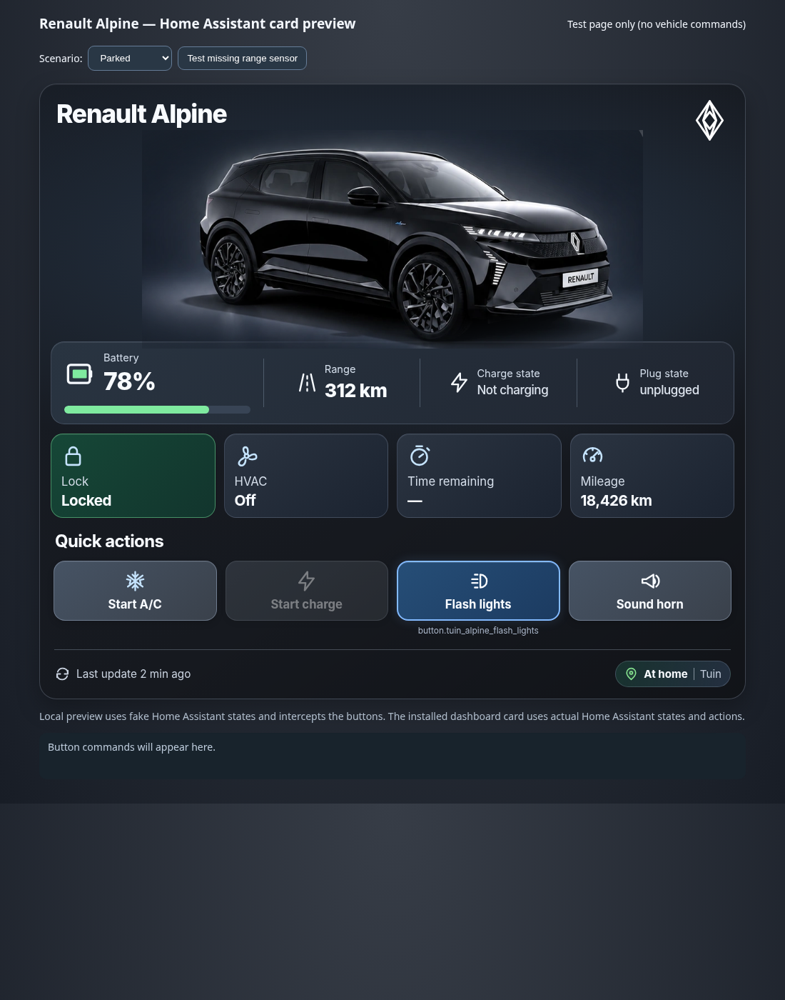

# Renault Alpine — Home Assistant Dashboard Card



An independent **Dashboard / Lovelace** card that works with Home Assistant's [official Renault integration](https://www.home-assistant.io/integrations/renault). The card presents the car, charging information, lock and HVAC states, charging time remaining, mileage, location and remote-action buttons in a compact Graphite design.

**Dashboard card, not an integration.** It creates **no new entities**; the official Renault integration is required. This project has the same HACS-friendly `hacs.json` approach as [iCal Flight Tracker](https://github.com/737oli/Flightradar_HA_App), but must be added to HACS as a **Dashboard**, not an Integration.

### Screenshots

| Desktop | Compact phone layout |
|:--:|:--:|
|  |  |

## HACS installation (custom repository)

> **GitHub repository must be public.** HACS cannot install private GitHub repositories. If this repository is still private, make it public under **GitHub → Settings → General → Danger Zone → Change repository visibility**. Before making it public, remove vehicle-specific names or locations from sample configs if you don't want them published. The code contains no secrets or Renault credentials.

1. In Home Assistant, open **HACS / Marketplace** (the label depends on your version).
2. Open the **⋮** menu, choose **Custom repositories**, and enter:

   ```text
   https://github.com/737oli/renault-alpine-ha-card
   ```

3. Choose repository type **Dashboard** (older installations may say **Lovelace** or **Plugin**), **not Integration**.
4. Add the repository, open **Renault Alpine Vehicle Card**, and select **Download/Install**.
5. Allow HACS to register the JavaScript dashboard resource. If your dashboard manages resources via YAML, register the resource manually as a **JavaScript module** at:

   ```text
   /hacsfiles/renault-alpine-ha-card/renault-alpine-card.js
   ```

   The HACS resource URL may have a changing version query (`?v=...`). Keep the version HACS generates when available. If the card doesn't appear immediately, fully reload the browser or app.
6. Edit your dashboard → **Add card** → search for **Renault Alpine** or choose **Manual** and paste the contents of [`card-config.yaml`](card-config.yaml).
7. In the card editor, expand **Entity mapping** and select the actual Renault entity IDs from **Settings → Devices & services → Renault → your vehicle**.

No changes to `configuration.yaml` are needed. **Do not separately add a `/local/renault-alpine/...` resource if HACS already installed the card**, or the same custom element may load twice.

### Distribution and artwork

The Renault emblem in the top-right is vector-traced directly from the user-supplied logo, drawn white inside the card, and does not need a separate image file. Primary text is explicitly white even under light Home Assistant themes. Flash lights uses the same button style as the other actions without an entity subtitle.

`hacs.json` declares `filename: renault-alpine-card.js`. HACS finds the release-ready files together in `dist/` and installs both:

- `dist/renault-alpine-card.js` — dependency-free ES module containing the JavaScript, HTML and CSS.
- `dist/alpine-hero.webp` — the vehicle artwork.

The card resolves `alpine-hero.webp` **relative to its own loaded JavaScript module** via `import.meta.url`. Therefore the image works for HACS and manual installations without editing a path. You can still override the image through the card editor if desired.

### Manual installation (without HACS)

Copy both files from `dist/` into Home Assistant at `/config/www/renault-alpine/` using **Settings → Apps → File editor** or another file-upload tool:

- `/config/www/renault-alpine/renault-alpine-card.js`
- `/config/www/renault-alpine/alpine-hero.webp`

Add a resource in **Settings → Dashboards → Resources**:

```text
/local/renault-alpine/renault-alpine-card.js?v=1.1.1
```

Choose **JavaScript module**, then add the same `custom:renault-alpine-card` dashboard card. If the `www` directory was newly created, Home Assistant might require a restart before serving `/local/` files. The UI editor handles all card settings; `configuration.yaml` does not need changing.

## Example dashboard card

```yaml
type: custom:renault-alpine-card
title: Renault Alpine
entity_prefix: tuin_alpine
location_suffix: Tuin
colors:
  battery: '#7fea9f'
  highlight: '#83baff'
  statusIcons: '#c5e3fd'
icons:
  weight: regular
  time: timer
  flash: headlights
options:
  compact: true
  confirmHorn: true
entities:
  flashLights: button.tuin_alpine_flash_lights
```

The `tuin_alpine` entity prefix, location label and flash button entity are **examples from this project's setup**. Other entity names are automatically proposed from the prefix and must be verified for your car. You can override any field in the card editor. No credentials are stored in the card.

## Supported information and actions

- **Readings:** Battery, electric range, charging status, plug status, locking status, HVAC, charging time remaining, mileage, location and most recent battery activity.
- **Commands:** Start A/C, stop A/C (requires Renault vehicle ID), start/stop charging if supported, flash lights, sound horn (with confirmation).
- **Safety:** Unavailable commands stay disabled; values not supplied by Renault show `—`. Stop A/C requires the official Renault vehicle ID, which you can inspect using the Home Assistant visual action editor (without executing it). The lock tile is **read-only**: for Home Assistant's `lock` binary sensor, `on` is unlocked and `off` is locked.
- **Refresh:** Renault cloud polling can delay updates. A successful button press means Home Assistant accepted the request, not that the vehicle action has completed.

The only entity ID directly confirmed by the original project is `button.tuin_alpine_flash_lights`. Check other IDs under **Settings → Devices & services → Renault → your vehicle**. Some features require an eligible Renault subscription.

## Updating and development

HACS uses GitHub commit versions until you publish a GitHub release. **No release is required to install a custom repository.** A versioned release can be published later through GitHub Releases, using a tag such as `v1.1.1` (make sure it contains the `dist` files). HACS checks for updates and refreshes the resource version after installation.

The package files are in `dist/`; changes to the dashboard JavaScript must be made there. Open [`preview.html`](preview.html) locally using a development web server to simulate Home Assistant sensor states and actions without touching your car:

```bash
python3 -m http.server 8000
# then open http://localhost:8000/preview.html
node --check dist/renault-alpine-card.js
```

GitHub Actions checks JavaScript syntax and runs the official HACS repository validator (category `plugin`). Until the repository is public, the HACS validation job and HACS installation may not work, even though the JavaScript syntax check can run.

## Attribution / license

Community-created UI; **not affiliated with Renault, Alpine, or Home Assistant**. Brand names and logos belong to their respective owners. No open-source license has been selected yet. Choose a license before inviting contributions or seeking inclusion in the default HACS catalog.