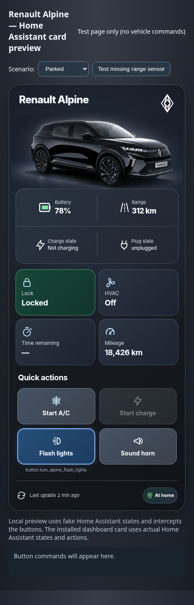

# Renault Alpine Vehicle Card

**A premium vehicle dashboard for Home Assistant.** Monitor your Renault's essential information and access supported remote functions from one elegant, responsive card.


Designed with a graphite finish, clear status indicators, and a layout that feels at home on both desktop and mobile dashboards.

## Features

| Vehicle information | At a glance |
| --- | --- |
| **Battery & range** | Current battery percentage, a visual charge bar, and estimated remaining driving range |
| **Charging** | Charging status, plug connection, and estimated time remaining |
| **Vehicle status** | Door-lock status, cabin climate status, and recorded mileage |
| **Location & updates** | Vehicle location and the most recent available update |

### Quick actions

Control supported Renault functions directly from the card:

- **Climate control** — start or stop cabin air conditioning, where supported.
- **Charging** — start or stop charging, where supported.
- **Flash lights** — remotely flash the vehicle lights.
- **Sound horn** — activate the horn, with a confirmation prompt.

The card automatically disables actions that are unavailable for your vehicle. Lock information is **display-only**; the card does not remotely lock or unlock the vehicle.

## Gallery

| Desktop | Mobile |
| :---: | :---: |
|  |  |

## Requirements

- A working **Home Assistant** installation.
- The official [Renault integration](https://www.home-assistant.io/integrations/renault/) configured with your vehicle.
- **HACS** installed for easy installation and updates.

Available information and remote actions depend on your Renault model, connected services, and subscription. Not every vehicle supports every feature.

## Install with HACS

1. Open **HACS** in Home Assistant.
2. Open the **⋮** menu and select **Custom repositories**.
3. Add this repository:
   
   ```text
   https://github.com/737oli/renault-alpine-ha-card
   ```

4. Choose **Dashboard** as the category and add the repository.
5. Open **Renault Alpine Vehicle Card** in HACS and select **Download**.
6. Refresh your Home Assistant dashboard if the new card is not shown immediately.

### Add the card to your dashboard

1. Open your dashboard and select **Edit dashboard → Add card**.
2. Search for **Renault Alpine** and add the card.
3. Open the card's **visual editor**.
4. Set the vehicle's entity prefix, then use **Entity mapping** to confirm the correct Renault sensors and action buttons.
5. Save the card.

You can find your vehicle's entities under **Settings → Devices & services → Renault → your vehicle**.

**No changes to `configuration.yaml` are required.**

## Personalize your dashboard

The visual editor lets you customize the card without editing files:

- Change the card title and location label.
- Adjust the battery and accent colors.
- Choose icon styles and compact spacing.
- Select a different vehicle image if you prefer.
- Match displayed information and actions to your own Renault entities.

The included vehicle artwork loads automatically. The graphite theme maintains high-contrast text across Home Assistant themes.

## Good to know

**Why do some values show “—”?** The vehicle may not have reported the information yet, or the matching entity may be missing or unavailable. Check the Renault entities in Home Assistant and verify the card's entity mappings.

**Why is an action unavailable?** Your model, Renault connected-services package, or Home Assistant integration may not expose that function. Only supported actions can be used.

**Why hasn't the car updated after a command?** Renault cloud updates can be delayed. A command accepted by Home Assistant does not necessarily mean the vehicle has already completed it.

**Why does the old design still appear?** Check for an update in HACS, then fully refresh your browser or restart the Home Assistant mobile app. If you previously installed the card manually, remove any outdated duplicate dashboard resource after confirming the HACS version works.

## Updates and support

Updates are provided through **HACS**. Check the [Releases](https://github.com/737oli/renault-alpine-ha-card/releases) page for changes and new versions.

Found a problem or have an idea? Open an [issue on GitHub](https://github.com/737oli/renault-alpine-ha-card/issues).

## License and disclaimer

Released under the [MIT License](LICENSE).

This is an independent community project and is **not affiliated with or endorsed by Renault, Alpine, or Home Assistant**. All trademarks and brand assets belong to their respective owners. Remote vehicle actions should not be relied upon for safety-critical situations.
